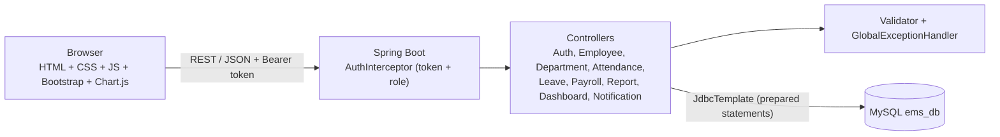
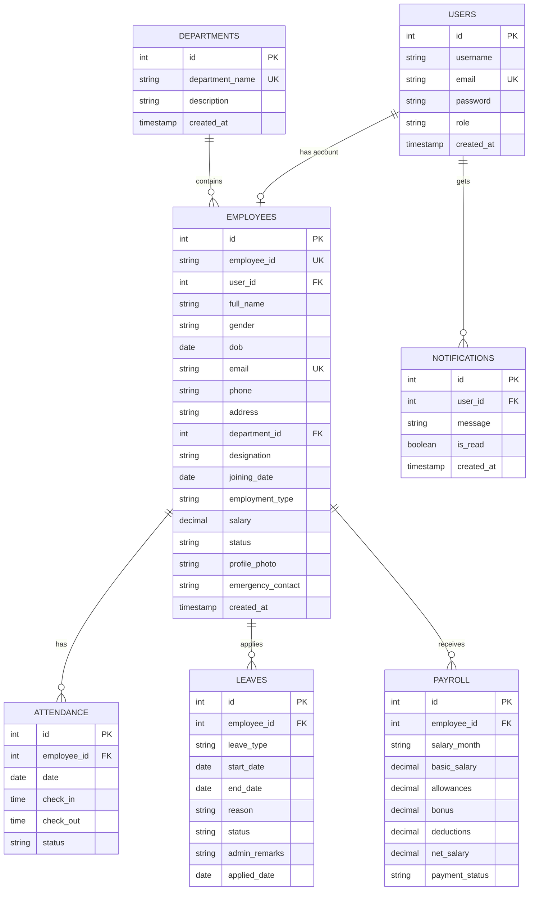
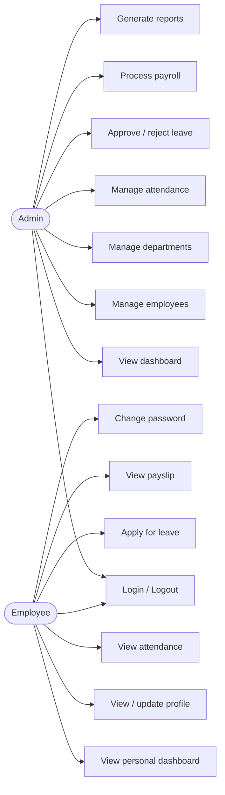
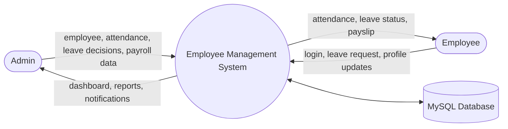
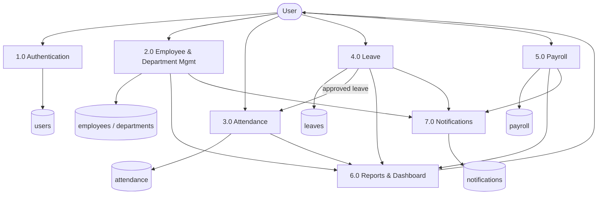
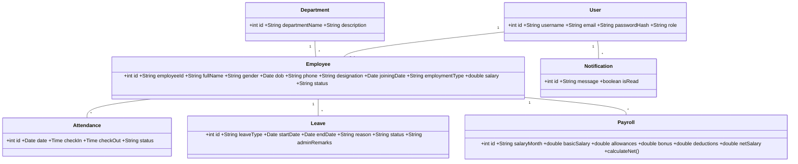

# Employee Management System - Project Documentation

> Diagrams are written in **Mermaid**. They render automatically in GitHub, VS Code (Markdown Preview Mermaid Support) and https://mermaid.live - export them as images to paste into Word.

## 1. Abstract
The Employee Management System (EMS) is a web-based application that centralizes employee information, departments, attendance, leave and payroll. It replaces paper registers and scattered spreadsheets with one secure database. Administrators get a live dashboard and reports, while employees can see their own attendance, apply for leave and view payslips. The system is built with Spring Boot, MySQL and Bootstrap, uses BCrypt password hashing and role-based access control, and is designed to reduce paperwork, remove duplicate records and give fast, accurate information for decision making.

## 2. Problem Statement
Many small and medium organizations still keep employee data in paper files and Excel sheets. This causes duplicate and inconsistent records, slow searching, calculation mistakes in salary, lost leave applications, no real-time view of attendance, poor data security and a lot of manual effort for HR staff when reports are needed.

## 3. Existing System
- Employee details are stored in files or separate spreadsheets.
- Attendance is marked in a physical register; leave is applied on paper and approved by signature.
- Salary is calculated manually, so errors are common.
- Searching a record or preparing a report takes hours.
- No access control: anyone with the file can see salary information.
- No backup, no history, no notifications; employees must ask HR for every detail.

## 4. Proposed System
EMS stores everything in a relational MySQL database and exposes it through a secure web application.
- One record per employee with unique Employee ID and email (duplicates are blocked).
- Instant search and filters, dashboard with charts, and printable reports.
- Online leave workflow with approval, remarks and notifications; approved leave updates attendance automatically.
- Payroll with an automatic net salary formula and printable payslips.
- Role-based security: Admin manages everything, Employee sees only personal data.

## 5. Objectives
1. Maintain all employee information in one centralized database.
2. Eliminate duplicate records and manual paperwork.
3. Provide fast search and filtering of employees, attendance and leave.
4. Automate attendance tracking, leave approval and salary calculation.
5. Provide an admin dashboard and reports for monitoring.
6. Provide employees with self-service access.
7. Secure the data with authentication, hashing and role-based authorization.

## 6. Scope
**Covered:** authentication, employee/department management, attendance, leave, payroll and payslips, reports, notifications, dashboards for admin and employee.
**Not covered (future work):** biometric devices, real e-mail/SMS sending, tax computation, performance appraisal, recruitment.

## 7. Functional Requirements
| ID | Requirement |
|---|---|
| FR1 | Users log in with email and password; redirected to the dashboard for their role |
| FR2 | Users can log out, change password and reset a forgotten password |
| FR3 | Admin adds, edits, views, deactivates / activates employees |
| FR4 | Admin searches employees by ID, name, email, department, designation, status |
| FR5 | Admin manages departments and views employees of a department |
| FR6 | Admin marks and edits attendance; filters by employee, date, status |
| FR7 | Employee views own attendance history |
| FR8 | Employee applies for leave (type, dates, reason) and sees status |
| FR9 | Admin approves/rejects leave with remarks |
| FR10 | Admin processes payroll (basic, allowances, bonus, deductions, net) |
| FR11 | Employee views salary details and prints payslip |
| FR12 | Admin generates employee, department, attendance, leave, payroll reports with print / CSV export |
| FR13 | Dashboard shows statistics and 5 charts from live data |
| FR14 | System generates notifications for key events |
| FR15 | Employee can update allowed profile fields (phone, address, emergency contact, photo) |

## 8. Non-Functional Requirements
- **Security:** BCrypt hashed passwords, token authentication (8-hour expiry), role-based access on every API, parameterized queries (SQL injection safe), output escaping (XSS), input validation on client and server.
- **Performance:** typical page loads under 2 seconds; list screens use paging; indexed unique keys for lookups.
- **Reliability:** transactions for multi-table writes (employee + login), foreign keys keep data consistent, soft delete keeps history, centralized error handling.
- **Usability:** responsive Bootstrap UI (desktop, tablet, mobile), clear messages, confirmations, empty states, loading indicators.
- **Scalability:** layered, stateless REST backend; database can be moved to a server; token store can be replaced by Redis/JWT; modules are independent.

## 9. Hardware Requirements
| Item | Minimum |
|---|---|
| Processor | Dual-core 2.0 GHz |
| RAM | 4 GB (8 GB recommended) |
| Storage | 2 GB free |
| Display | 1366 x 768 |

## 10. Software Requirements
Windows / Linux / macOS, JDK 17, Maven 3.8+, MySQL 8, Chrome / Edge / Firefox, IDE (IntelliJ IDEA / Eclipse / VS Code), Git (optional).

## 11. System Architecture

**Layers:** Presentation (frontend) -> Security (interceptor) -> Business/Controller -> Data (JDBC + MySQL).
Every `/api/**` request passes through `AuthInterceptor`, which checks the token and the role before the controller runs. Errors are converted to a friendly `{"message": ...}` by `GlobalExceptionHandler`.

## 12. ER Diagram

## 13. Use Case Diagram

## 14. Data Flow Diagrams
**Level 0 (context diagram)**

**Level 1**

## 15. Class Diagram

Backend classes: `AuthController`, `EmployeeController`, `DepartmentController`, `AttendanceController`, `LeaveController`, `PayrollController`, `ReportController`, `DashboardController`, `NotificationController`, `AuthInterceptor`, `TokenStore`, `Notifier`, `Validator`, `GlobalExceptionHandler`, `ApiException`, `AuthUser`.

## 16. Database Schema
Full SQL with sample data: `database/schema.sql`. Summary:

| Table | Columns (PK = primary key, FK = foreign key) |
|---|---|
| users | **id PK**, username, email (unique), password (BCrypt), role (ADMIN/EMPLOYEE), created_at |
| departments | **id PK**, department_name (unique), description, created_at |
| employees | **id PK**, employee_id (unique), user_id FK->users, full_name, gender, dob, email (unique), phone, address, department_id FK->departments, designation, joining_date, employment_type, salary, status, profile_photo, emergency_contact, created_at |
| attendance | **id PK**, employee_id FK->employees, date, check_in, check_out, status; unique(employee_id, date) |
| leaves | **id PK**, employee_id FK->employees, leave_type, start_date, end_date, reason, status, admin_remarks, applied_date |
| payroll | **id PK**, employee_id FK->employees, salary_month (YYYY-MM), basic_salary, allowances, bonus, deductions, net_salary, payment_status; unique(employee_id, salary_month) |
| notifications | **id PK**, user_id FK->users, message, is_read, created_at |

## 17. Testing - Test Cases
| ID | Module | Test case | Steps / input | Expected result | Status |
|---|---|---|---|---|---|
| TC01 | Login | Valid admin login | admin@example.com / Admin@123 | Admin dashboard opens | ☐ |
| TC02 | Login | Valid employee login | employee@example.com / Employee@123 | Employee dashboard opens, admin menu hidden | ☐ |
| TC03 | Login | Wrong password | admin@example.com / wrong | "Invalid login credentials." | ☐ |
| TC04 | Login | Empty fields | Submit blank form | Validation messages shown | ☐ |
| TC05 | Login | Deactivated user | Login as suresh.b@example.com | "Your account is deactivated..." | ☐ |
| TC06 | Security | Employee opens admin URL | Open `#employees` as employee | Redirected to dashboard; API returns 403 | ☐ |
| TC07 | Security | API without token | GET /api/employees with no header | 401 "Your session has expired..." | ☐ |
| TC08 | Add employee | Valid data | Fill all required fields | "Employee added successfully." and appears in list | ☐ |
| TC09 | Add employee | Duplicate email | Use existing email | "An employee with this email already exists." | ☐ |
| TC10 | Add employee | Duplicate employee ID | Use EMP001 | "Employee ID already exists." | ☐ |
| TC11 | Add employee | Invalid phone / email | phone `123`, email `abc` | Validation message shown | ☐ |
| TC12 | Edit employee | Change designation | Edit -> Save | "Employee updated successfully." | ☐ |
| TC13 | Delete employee | Deactivate | Click deactivate -> confirm | Status becomes Inactive, history kept | ☐ |
| TC14 | Attendance | Mark attendance | Select employee, date, Present | "Attendance marked successfully." | ☐ |
| TC15 | Attendance | Duplicate entry | Same employee + date again | "Attendance is already marked..." | ☐ |
| TC16 | Attendance | Check-out before check-in | 18:00 in, 09:00 out | Error message shown | ☐ |
| TC17 | Attendance | Employee view | Login as employee | Only own records visible | ☐ |
| TC18 | Leave | Apply leave | Type, dates, reason | Status Pending, admin notified | ☐ |
| TC19 | Leave | End date before start | Wrong dates | "End date cannot be before start date." | ☐ |
| TC20 | Leave | Approve leave | Admin approves with remarks | Status Approved, employee notified, attendance = Leave | ☐ |
| TC21 | Leave | Reject leave | Admin rejects | Status Rejected with remarks | ☐ |
| TC22 | Payroll | Net salary calculation | Basic 50000, Allow 10000, Bonus 2000, Ded 5000 | Net = 57000 | ☐ |
| TC23 | Payroll | Duplicate month | Same employee + month | "Payroll ... already exists." | ☐ |
| TC24 | Payroll | Payslip | Open payslip -> Print | Payslip shown and print dialog opens | ☐ |
| TC25 | Search | Search employee | Type "Priya" | Only matching employees listed | ☐ |
| TC26 | Search | Filter dept + status | IT + Active | Correct filtered list | ☐ |
| TC27 | Reports | Attendance report | Select dates + Generate | Records shown, Print and CSV work | ☐ |
| TC28 | Reports | Payroll report | Month range | Payroll rows shown | ☐ |
| TC29 | Password | Weak new password | `abc123` | Strength error shown | ☐ |
| TC30 | XSS | Name `` | Save employee | Displayed as text, script not run | ☐ |

*(Tick the Status column yourself after running each test before you submit.)*

## 18. Future Enhancements
- Biometric / face-recognition attendance
- Email and SMS notifications
- Mobile application
- AI-based employee analytics (attrition prediction, performance insights)
- Cloud deployment (AWS / Azure) with Docker
- Performance appraisal, document upload, tax and PF calculation
